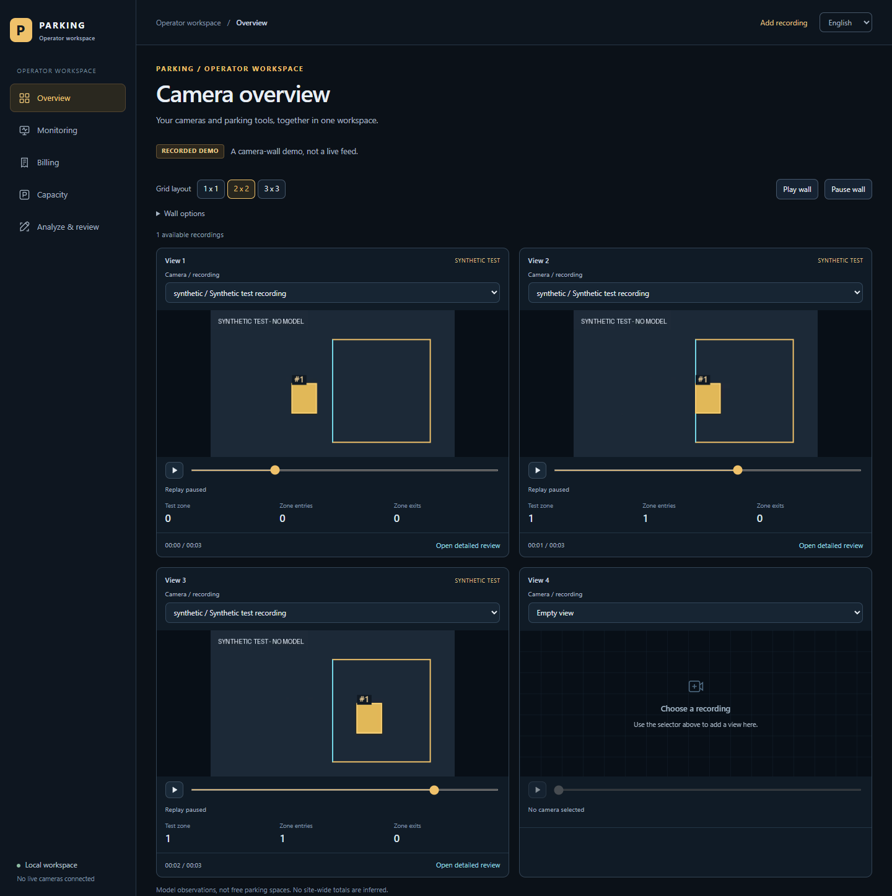
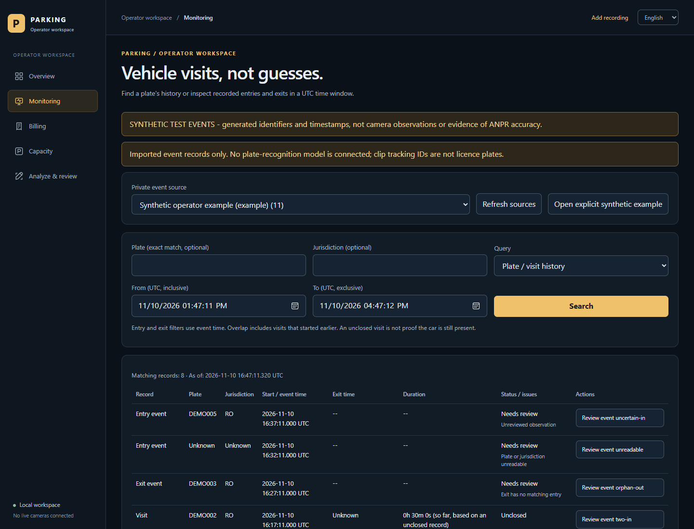
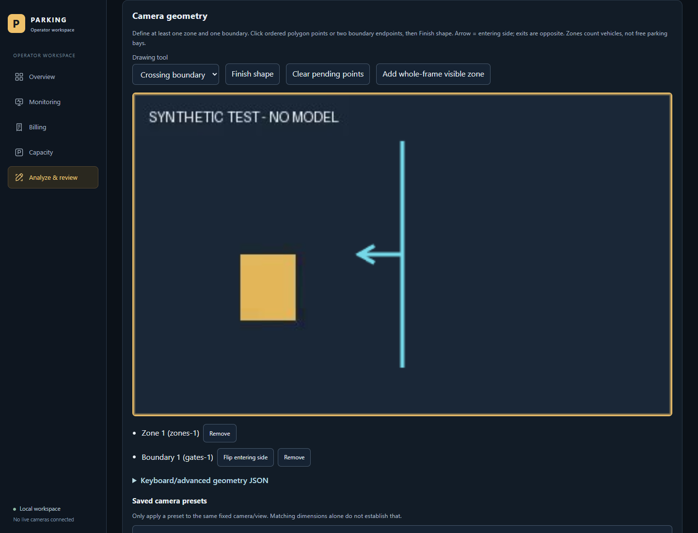
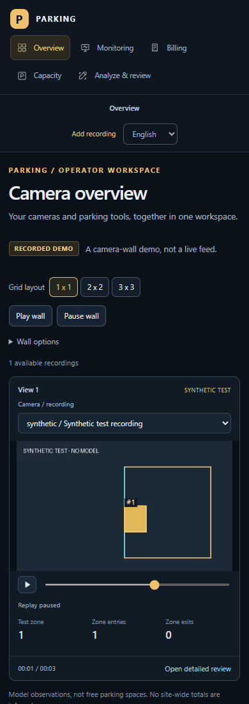

# Parking Analytics

A local dashboard for turning recorded parking video into inspectable observations.
Review vehicle detections and crossings, query authorized plate-event logs, and
preview fees or mapped-space capacity without disguising unknowns as results.



*Actual app screenshots using original MIT-licensed synthetic fixtures only—no
MEVA frames or private runtime records. UI demonstrations, not live operations
or evidence of model/ANPR quality.*

<table>
  <tr>
    <td width="50%"><br><strong>Monitoring</strong> · Exact queries and reviewable event history.</td>
    <td width="50%"><br><strong>Analyze &amp; review</strong> · Draw zones and crossing boundaries.</td>
  </tr>
</table>

<details>
<summary>Mobile dashboard preview</summary>

</details>

## One dashboard, four tools

The shared sidebar and English/Romanian controls keep each workflow in one app.

| Workspace | What it does |
|---|---|
| **Overview** | A 1/4/9-view recorded camera wall with per-view clip selection, play/pause/seek/loop controls, synchronized detector boxes, zone counts and crossings. |
| **Monitoring** | Authorized plate-event imports, exact plate/time queries, incomplete-visit review and auditable corrections. No automatic plate recognition. |
| **Billing** | Explicit-tariff previews for complete, unambiguous visits or supplied times; exact minor-unit arithmetic, not payment processing. |
| **Capacity** | Operator-input mapped-space arithmetic that preserves unknowns. Vehicle counts never become a free-bay estimate. |
| **Analyze & review** | Private drag/drop recordings, confirmed recording times, visual zones and finite boundaries, saved presets, cancellable model processing, replay and private CSV/JSON exports. |

The wall remembers demo layout preferences only. Completed private analyses can
be added through explicit per-visit opt-in and selection; their names and IDs
are not saved in browser layout preferences.

## Run locally

Requirements: **uv**, **Python 3.12** (uv-managed), and **Node.js compatible with
Vite 7** (Node 24 was used). Review [setup, local caches and resource
budgets](docs/SETUP.md) before installing; the Windows inference dependencies
include large pinned PyTorch wheels.

From the repository root in **PowerShell**:

```powershell
uv sync --extra app --extra inference
Set-Location .\viewer
npm.cmd install --no-audit --no-fund --cache '..\.cache\npm'
npm.cmd run build
Set-Location ..
uv run --no-sync parking serve
```

Open **http://127.0.0.1:8000** for the dashboard and local API.

**Fresh checkout:** generated demo media and model weights are not in Git.
Follow the [demo and model preparation instructions](docs/SETUP.md) for recorded
playback or new analysis. Missing demo assets are reported, never replaced with
invented footage or detections. Monitoring starts empty; synthetic examples are
an explicit opt-in.

Inference is optional until queuing analysis, which requires the cached pinned
model. For app-only use, `uv sync --extra app` is sufficient—but **removes optional
inference packages**. Use both extras to retain them and `uv run --no-sync` after
setup. Serving the app does not load a model while idle.

## Know what the results mean

- The three MEVA G328 segments show **one camera at different historical times**,
  not simultaneous cameras or a current-site total. No live-camera, RTSP or
  webcam integration is connected.
- Zone counts describe visible vehicles, including movers—not occupied marked
  bays, whole-site occupancy or available parking spaces.
- Replay reference labels are **provisional, not human-verified**. Model
  observations are not measured accuracy, plate identities or billable visits.
- Recording-time metadata provides candidates only. Confirm an offset-aware
  first-frame time and the **1x real-time assumption** before analysis.
  Burned-in/on-screen timestamp OCR is not implemented.
- Analysis runs one job at a time with progress, cancellation and a **30-minute
  run limit**. Uploads are limited to **512 MiB and ten minutes**; see the
  [operator guide](docs/OPERATIONS.md) for format and geometry limits.

## Privacy and deployment

This is an **unauthenticated, loopback-only local prototype**, not a
production-ready or publicly deployed service. Do not expose it publicly.
No automatic retention policy is enabled.

Authorized recordings, real plate logs and private results belong in ignored
private storage—not Git, screenshots or the static viewer assets. Public
deployment needs a separately designed authentication and retention policy.

## Guides

- [Setup & reproduction](docs/SETUP.md) — installation, caches, demo preparation,
  bounded processing, checks and detailed commands.
- [Operator guide](docs/OPERATIONS.md) — imports, queries, review, tariffs,
  recording setup and private-data handling.
- [Methodology](docs/METHODOLOGY.md) — frozen protocol, observation semantics
  and evidence limits.
- [Data & licences](docs/DATA_AND_LICENSES.md) — attribution, model/dependency
  terms and presentation boundaries.

To refresh the synthetic screenshots, run `npm.cmd run screenshots` in `viewer`
after setup. Capture uses an isolated test database/browser, no inference, and
writes `docs\screenshots`.

## Licence and demo footage

Original source code and screenshot fixtures are [MIT](LICENSE). Separately,
the optional MEVA KF1 replay uses footage by **Kitware Inc. and IARPA**, licensed
[CC BY 4.0](https://creativecommons.org/licenses/by/4.0/), with selected excerpts,
cropping, resizing, transcoding and overlays. MEVA footage is not shown in these
screenshots; no dataset-author endorsement is implied. Model weights and
third-party dependencies retain their separate terms.

**Privacy/publicity clearance for public footage presentation remains
incomplete.** A copyright licence alone does not establish that clearance;
see [sources and presentation boundaries](docs/DATA_AND_LICENSES.md).
